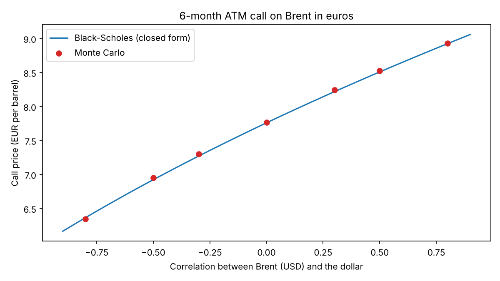

# Oil & FX: Pricing a Brent Option in Euros

A European buyer pays its oil in USD but earns EUR. This project prices a call option on the
Brent price expressed in euros and measures how the oil / dollar correlation changes its cost.



## Method

- Brent in USD and the dollar value in EUR are two correlated geometric Brownian motions.
- Monte Carlo pricing (200,000 paths) under the euro risk-neutral measure, with the quanto drift
  adjustment `- rho * sigma_oil * sigma_fx` on the Brent price.
- Check against Black-Scholes: the product of two lognormals is lognormal, with volatility
  `sqrt(sigma_oil^2 + sigma_fx^2 + 2 * rho * sigma_oil * sigma_fx)`.

## Results

Illustrative parameters (not estimated from market data): Brent 80 USD, EUR/USD 1.10,
volatilities 35% and 8%, rates 4% (USD) and 2.5% (EUR). At-the-money call, 6 months.

| Correlation | Volatility in EUR | Monte Carlo (EUR) | Black-Scholes (EUR) | vs rho = 0 |
|---|---|---|---|---|
| -0.8 | 29.00% | 6.346 | 6.364 | -18.0% |
| -0.5 | 31.76% | 6.951 | 6.923 | -10.8% |
| -0.3 | 33.48% | 7.298 | 7.270 | -6.3% |
| 0.0 | 35.90% | 7.768 | 7.760 | 0.0% |
| +0.3 | 38.17% | 8.244 | 8.218 | +5.9% |
| +0.5 | 39.61% | 8.528 | 8.508 | +9.6% |
| +0.8 | 41.68% | 8.932 | 8.925 | +15.0% |

For rho = -0.30, Monte Carlo and Black-Scholes agree within 0.13%. A negative correlation
(oil up, dollar down) makes the dollar a partial natural hedge and lowers the option price.

## Limitations

- Illustrative parameters; constant volatility and correlation; no jumps.
- Oil is modelled as a spot asset without convenience yield (no futures curve).

## Run

```bash
pip install numpy scipy matplotlib
python brent_eur_option.py
```

A detailed write-up is in `2_oil_fx_option_pricing.pdf`.
